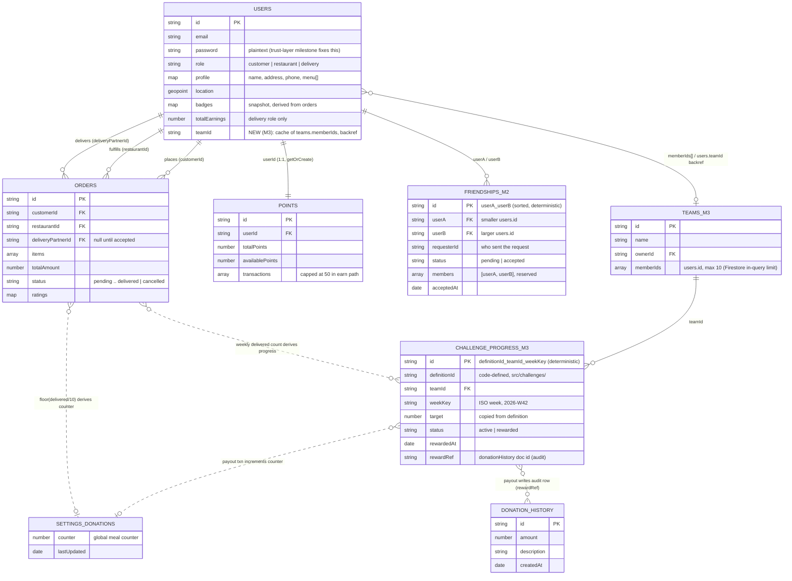

# Firestore DB Design — M2 (Social Leaderboard) & M3 (Teams + Challenges)

Status: **design approved, not yet implemented.**
This document is self-contained so anyone (or any coding agent) can implement
against it locally without extra context. All facts about the current schema
were extracted from the actual code — file references are given throughout.

---

## 1. Current schema (as implemented today)

Key facts an implementer must know:

- **IDs**: the auto-generated Firestore document id of a `users` document
  (also copied into the doc's `id` field, `server/models/User.js:55-60`) is
  the single identifier used everywhere. `customerId`, `restaurantId`,
  `riderId`, `deliveryPartnerId`, `userId` all refer to `users.id`.
- **All three roles live in one collection**: customers, restaurants, and
  delivery partners are all `users` docs distinguished by `role`. Even a
  restaurant's menu lives at `users.profile.menu`
  (`server/routes/restaurant.js:99`).
- **Badges are not a collection**: they are derived from `orders` by
  `server/services/buildCustomerStats.js` and persisted as a snapshot merged
  into the `users` doc (`server/services/badgeService.js:17-25`).
  "Derive on read + snapshot cache" is this repo's established pattern.
- **Donations have no per-user data**: only a global counter at
  `settings/donations` (`server/routes/donations.js:51-66`). Per-user
  donation impact must be derived from the user's delivered-order count
  (Meal-for-a-Meal rule: 1 meal per 10 delivered orders).
- `restaurants` is a half-dead parallel collection used only by
  `server/models/Restaurant.js`; the live flows read `users`. Do not build
  on it.

| Collection | Main fields | Relations | Used by |
|---|---|---|---|
| `users` | `id`, `email`, `password` (plaintext), `role`, `profile{name,address,phone,menu[]}`, `location` (GeoPoint), `deliveryStatus`, `totalEarnings`, badge snapshot (`badges{}`, `badgesStats`, `badgesLastComputedAt`), `createdAt/updatedAt` | hub of everything | `models/User.js`, `routes/auth.js`, `routes/customer.js`, `routes/restaurant.js`, `services/badgeService.js` |
| `orders` | `id`, `customerId`, `restaurantId`, `items[]`, `totalAmount`, `tipAmount`, `deliveryFee`, `deliveryAddress{}`, `status` (`pending..delivered/cancelled`), `deliveryPartnerId`, `assignedAt`, `ratings{customer:{rating,review}}`, `createdAt/updatedAt` | 3 refs to `users.id` | `routes/orders.js`, `routes/delivery.js`, `routes/customer.js`, `routes/donations.js`, `services/buildCustomerStats.js` |
| `points` | `id`, `userId`, `userRole`, `totalPoints`, `availablePoints`, `usedPoints`, `transactions[{type,points±,description,orderId,createdAt}]` (earn path caps at 50) | 1:1 with `users` | `models/Points.js`, `routes/points.js`, `routes/delivery.js` |
| `settings` | single doc `donations`: `counter`, `lastUpdated` | global, no user link | `routes/donations.js` |
| `donationHistory` | `id`, `amount`, `description`, `createdAt` | no user/order link | `routes/donations.js` |

---

## 2. New collections

### 2.1 `friendships` (M2)

One document per pair. **Document id is deterministic**: sort the two user
ids lexicographically and join with `_` → `${userA}_${userB}`. A duplicate
or reverse-direction request therefore collides with the existing doc and
is idempotent by construction; existence checks are a single `get`.

Status is `pending | accepted` only. Rejection = delete the document
(re-requesting is allowed). Blocking is out of scope per the Project 1b
milestone ("send/accept/list only").

| Field | Type | Required | Description |
|---|---|---|---|
| `id` | string | yes | `${userA}_${userB}` — same as the document id |
| `userA` | string | yes | lexicographically smaller `users.id` |
| `userB` | string | yes | larger `users.id` |
| `requesterId` | string | yes | who sent the request (equals `userA` or `userB`); only the other side may accept |
| `status` | string | yes | `'pending'` \| `'accepted'` |
| `members` | array | yes | `[userA, userB]` — unused today; reserved for a future `array-contains` single query |
| `createdAt` | Date | yes | repo convention |
| `updatedAt` | Date | yes | repo convention |
| `acceptedAt` | Date | no | set on accept |

**Listing a user's friendships**: run two equality queries and merge —
`where('userA','==',uid)` plus `where('userB','==',uid)`.
Do **not** use `array-contains`: the test double
(`proj2/tests/helpers/fakeFirestore.js:53`) throws on unsupported operators
and currently supports only `==, !=, in, <, <=, >, >=`.

Example:

```json
{
  "id": "aB3xK9_zQ7mP2",
  "userA": "aB3xK9",
  "userB": "zQ7mP2",
  "requesterId": "zQ7mP2",
  "status": "accepted",
  "members": ["aB3xK9", "zQ7mP2"],
  "createdAt": "2026-10-12T10:00:00Z",
  "updatedAt": "2026-10-12T11:30:00Z",
  "acceptedAt": "2026-10-12T11:30:00Z"
}
```

### 2.2 `teams` (M3)

One team per user (enforced at the API level). "My team" lookup is the
back-reference `users.teamId` — no array query needed. Members are capped
at 10 so weekly progress can be computed with a single Firestore `in`
query (limit 10).

**Source of truth: `teams.memberIds`.** `users.teamId` is a cache of the
same fact; on any disagreement, `memberIds` wins. Every join/leave MUST
update both documents in a single Firestore **batched write** so they
cannot diverge — do not write them in two separate calls.

Join rule: the owner may only add users who have an **accepted**
`friendships` doc with them — verified at the API level with one `get`
on the deterministic friendship id. This is where M3 depends on M2.

| Field | Type | Required | Description |
|---|---|---|---|
| `id` | string | yes | auto id |
| `name` | string | yes | team display name |
| `ownerId` | string | yes | creator (`users.id`) |
| `memberIds` | array | yes | member `users.id`s, owner included, **max 10** |
| `createdAt` | Date | yes | |
| `updatedAt` | Date | yes | |

Plus a new field on `users`: `teamId` (string, nullable) — a cache-only
back-reference (see source-of-truth rule above). Firestore is schemaless,
so no migration is needed.

### 2.3 `challengeProgress` (M3)

Challenge **definitions live in code**, not in Firestore — mirror the
existing badges pattern (`src/badges/badgeDefinitions.js` +
`src/badges/evaluateBadges.js`):

```js
// src/challenges/challengeDefinitions.js  (new file)
{
  id: 'weekly-team-orders-15',
  scope: 'team',
  period: 'weekly',
  metric: 'deliveredOrders',
  target: 15,
  reward: { type: 'donatedMeals', amount: 5 }
}
```

A new challenge type is a new definition object — no code change as long
as it uses an existing `metric`. A genuinely new metric requires one
selector function in the evaluator (that is the honest limit; same as
badges today).

`challengeProgress` stores the **reward ledger only**. Progress itself is
derived at read time (see invariants below).

**Document id is deterministic**: `${definitionId}_${teamId}_${weekKey}`.

| Field | Type | Required | Description |
|---|---|---|---|
| `id` | string | yes | `${definitionId}_${teamId}_${weekKey}`, e.g. `weekly-team-orders-15_tK4f8a_2026-W42` |
| `definitionId` | string | yes | ref into `challengeDefinitions` |
| `teamId` | string | yes | → `teams.id` |
| `weekKey` | string | yes | ISO week, e.g. `'2026-W42'` |
| `target` | number | yes | copied from the definition at creation (preserves the terms if the definition later changes) |
| `status` | string | yes | `'active'` \| `'rewarded'` |
| `rewardedAt` | Date | no | set on payout |
| `rewardRef` | string | no | `donationHistory` doc id created by the payout (audit trail) |
| `createdAt` | Date | yes | |
| `updatedAt` | Date | yes | |

Example:

```json
{
  "id": "weekly-team-orders-15_tK4f8a_2026-W42",
  "definitionId": "weekly-team-orders-15",
  "teamId": "tK4f8a",
  "weekKey": "2026-W42",
  "target": 15,
  "status": "rewarded",
  "rewardedAt": "2026-10-18T23:59:00Z",
  "rewardRef": "dH9x2c",
  "createdAt": "2026-10-12T00:00:00Z",
  "updatedAt": "2026-10-18T23:59:00Z"
}
```

---

## 3. Combined schema (existing + M2 + M3)



(Firestore has no foreign keys; every relation above is an app-level
convention. Dotted lines are derivations, not stored references.)

---

## 4. Invariants — every implementation MUST respect these

1. **Derive, don't double-book.** Challenge progress and leaderboard
   scores are computed from `orders`/`points` at read time. Never store a
   second copy of a number that `orders` already proves — Project 1a's
   UC18 finding (write-only `totalEarnings` ledger diverging from the
   client's recomputation) is the failure mode this prevents. Snapshot
   caches (badge pattern) are allowed, but they are caches, not truth.
2. **Reward exactly once = deterministic id + Firestore transaction.**
   Payout must run in a transaction that reads the `challengeProgress`
   doc, verifies `status !== 'rewarded'`, and atomically sets
   `status='rewarded'`, increments `settings/donations.counter`, and
   writes the `donationHistory` row. The deterministic id guarantees
   concurrent payout attempts collide on the same doc so the transaction
   serializes them. This is the same bug class as the Project 1a points
   double-spend (`server/routes/points.js:82-127`) — a plain
   read-then-update is NOT acceptable here.
3. **Leaderboard score formula** (per user):
   `points.totalPoints` + number of badge tiers earned (from the `users`
   badge snapshot) + `floor(deliveredOrderCount / 10)` (donation impact).
   Donation impact always derives from delivered orders, never from the
   mutable global counter (it is unauthenticated today and forgeable).
4. **Test-double compatibility.** `proj2/tests/helpers/fakeFirestore.js`
   supports only `==, !=, in, <, <=, >, >=` (line 53 throws otherwise)
   and, as of this writing, has no `runTransaction`. Before implementing
   the payout, check/extend the fake with transaction support. Friend
   listing must use the two-equality-query pattern, not `array-contains`.
5. **Identity caveat.** Until the Project 2 trust-layer milestone (JWT
   sessions) lands, callers assert their own id in the request body —
   same as the rest of the repo. Friend/team routes should take the
   caller id the same way for now and be switched to the authenticated
   id when the trust layer merges. Do not invent a separate auth scheme
   here.
6. **`delivered` is forgeable until the trust layer lands.** Challenge
   progress and donation scores derive from delivered-order counts, but
   today `PUT /api/orders/:id/status` accepts any transition from anyone
   (Project 1a finding, `routes/orders.js:184` — no guard). The derived
   numbers are only as trustworthy as the status transitions that feed
   them, so the trust-layer milestone (authenticated, guarded
   transitions) is a **prerequisite** for shipping the leaderboard or
   challenge rewards as "verified" — do not implement rewards against
   unguarded transitions and call them trustworthy.
7. **Team membership has one source of truth.** `teams.memberIds` is
   authoritative; `users.teamId` is a cache. Join/leave updates both in
   one batched write; on disagreement, `memberIds` wins.
8. **Leaderboard scaling policy.** The friends-scope board is derived in
   real time (≤ a user's friend count). The global board is O(N) reads
   if derived naively — serve it from a periodically refreshed top-K
   snapshot (badgeService-style cache), not from a live scan per
   request. Course-scale seed data makes the naive version work; the
   policy exists so nobody "optimizes" by storing scores as truth.
9. **Badge snapshot freshness is best-effort.** `users.badges` is only
   refreshed when the badge route runs. The leaderboard treats a missing
   or stale snapshot as 0 badge tiers rather than recomputing per
   request — acceptable at course scale, and documented so a low badge
   score is understood as staleness, not a bug.

Smaller notes an implementer should know:

- **Order ≠ checkout.** A multi-restaurant cart is split into one order
  per restaurant at checkout (`client/.../Cart.tsx:106`), so
  `deliveredOrders` metrics count order documents, not checkouts. A team
  can inflate "orders" by splitting carts; accepted at course scale —
  the definition language says "order documents" on purpose.
- **Week boundaries are UTC.** `weekKey` is the ISO week computed in
  UTC, so progress near Sunday midnight is unambiguous.
- **Composite index caveat.** `where('customerId','in',members)` plus a
  `createdAt` range needs a composite index on real Firestore; the
  emulator does not enforce indexes, so this only surfaces in
  production. Alternative that needs no index: one `==` query per member
  (≤10), merged in code.
- **Score weighting is a product decision, not a schema one.** The
  formula in invariant 3 is dollar-dominated (points track spend); the
  red-team round flagged the "disposable-income leaderboard" risk.
  Normalization/weighting should be settled by the M0 eval — the schema
  supports any weighting without change.

---

## 5. Implementation map

**Friendships (M2)**
- New: `server/models/Friendship.js`, `server/routes/friends.js`
  (send / accept / list / delete)
- Edit: `server/index.js` — register `app.use('/api/friends', ...)`
- Tests: new `proj2/tests/uc-friends.test.js` using the existing
  `tests/helpers/{fakeFirestore,buildApp}` harness (works as-is with the
  two-equality-query design)

**Leaderboard API (M2)**
- New: `server/services/leaderboardService.js` (pure score derivation —
  write and unit-test it before wiring any route),
  `server/routes/leaderboard.js` (`GET /api/leaderboard`, optional
  `?scope=friends`)
- Edit: `server/index.js`
- Client: new `client/src/components/customer/Leaderboard.tsx` + route
  registration; reuse the existing badge and points display components

**Teams + challenges (M3)**
- New: `src/challenges/challengeDefinitions.js`,
  `src/challenges/evaluateChallenges.js` (mirror `src/badges/`),
  `server/services/challengeService.js` (weekly aggregation + payout
  transaction), `server/routes/teams.js`, `server/routes/challenges.js`
- Edit: `server/index.js`; `users.teamId` field (no migration needed)
- Optional hook: `server/routes/delivery.js` delivery-completion handler
  (next to the existing points-award call) if push-style progress is ever
  wanted — not required with derive-on-read

**Reusable existing code**
- `src/badges/` definition+evaluator structure → template for challenges
- `services/badgeService.js` snapshot-merge pattern → leaderboard cache
- `models/Points.js` `getOrCreate` pattern
- `services/buildCustomerStats.js` order aggregation / timestamp
  normalization utilities → weekly filtering
- `tests/helpers/fakeFirestore.js` + `buildApp.js` test harness
